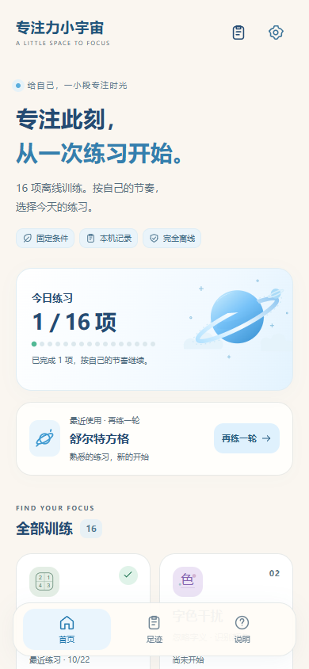
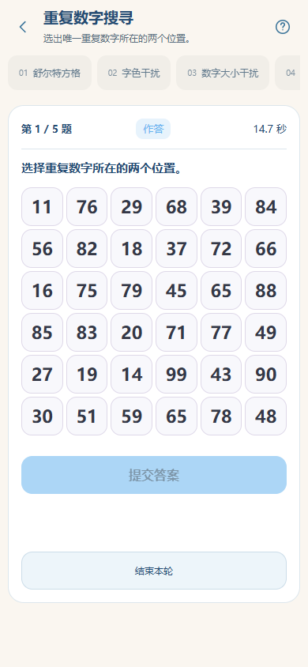
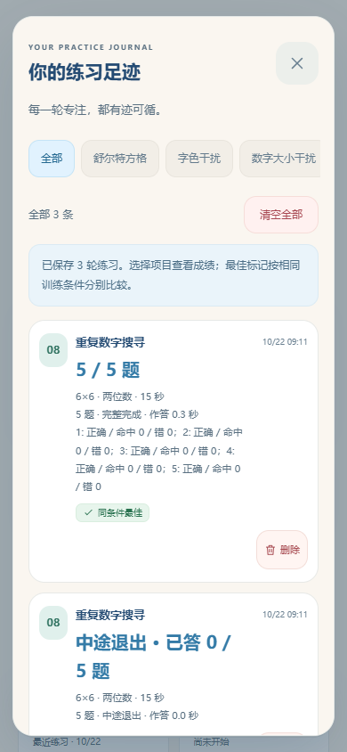

# 专注力小宇宙 · Attention Trainning

供自己和朋友使用的安卓离线注意训练工具，目前每个项目还没开始打磨，体验感一般。当前版本 **1.60 / versionCode 9**，Android 8.0+。包名 `cn.focusuniverse.offline`。

使用安卓原生外壳和系统 WebView，十六项训练、音频和页面全部内置。没有账号、广告、支付、服务器或联网权限。训练成绩不作为医学诊断或一般能力评分。

## 安装与预览

- [下载 1.60 APK](安卓手机版/专注力小宇宙-1.60.apk?raw=true)
- [下载完整交付 ZIP](安卓手机版/专注力小宇宙-1.60-安卓自用版.zip?raw=true)
- [更新说明](安卓手机版/更新说明-1.60.md) · [安装步骤](安卓手机版/安装与使用说明-1.60.md)
- [测试报告与限制](安卓手机版/验证记录-1.60.md) · [性能原始报告](安卓手机版/界面与性能验收-1.60.json)
- [界面动效录屏](安卓手机版/界面动效录屏-1.60.webm?raw=true)

更新前先在旧版导出备份，然后覆盖安装；不要先卸载或清除数据。签名身份与历史版本一致，但尚未进行安卓真机覆盖安装验证。

预览来自隔离浏览器，显示的成绩为测试数据。GitHub 中的 HTML 是源文件；下载完整 ZIP 后解压，使用浏览器打开其中的 `页面预览-1.60.html` 查看图集和视频。

| 首页 | 训练页 | 记录页 |
| --- | --- | --- |
|  |  |  |

## 十六项训练

| 编号 | 项目 | 编号 | 项目 |
| --- | --- | --- | --- |
| 1 | 舒尔特方格（含倒序） | 9 | 消失的物品 |
| 2 | 字色干扰 | 10 | 相似字符找异类 |
| 3 | 数字大小干扰 | 11 | 规则切换 |
| 4 | 六项序列记忆 | 12 | 呼吸聚焦与注意返回 |
| 5 | 视觉动态感知 | 13 | 中央与周边辨认 |
| 6 | 视觉完形整合 | 14 | 持续监测与停止点击 |
| 7 | 多目标追踪 | 15 | 双耳分听 |
| 8 | 重复数字搜寻 | 16 | 快速串行双目标识别 |

## 文件导航

```text
android-app/       安卓外壳、当前训练模块、UI、构建与测试脚本
_hub/             历史模板留档，当前安卓构建不再读取
index.html        原六项网页的嵌入数据（只读兼容输入）
六个训练 HTML     原六项引擎与校验基线，继续保留原路径
docs/             架构、构建、测试、数据兼容和本次整理说明
安卓手机版/       最新安装包、预览、验收报告及历史签名 APK
训练工具开发/     训练设计与研究依据留档
```

1.60 参考作者设计稿更新奶油浅蓝 UI、SVG 插画、底部导航、鼠标悬停和页面动效；训练引擎和原网页不改动。未上传签名私钥、SDK、缓存或个人训练备份。

## 开发

先阅读 [构建说明](docs/BUILD.md)、[架构说明](docs/ARCHITECTURE.md)、[测试入口](docs/TESTING.md) 和 [数据与签名边界](docs/DATA-AND-SIGNING.md)。

```powershell
python -X utf8 android-app/dev.py doctor
python -X utf8 android-app/dev.py release --jobs 3
```

训练注册表：`android-app/config/trainings.json`；界面：`templates/`、`styles/`、`app/`；验证：`tests/`；工程脚本：`tooling/`。
版本仅从 AndroidManifest.xml 读取。构建支持 Windows 与可配置工具路径，未验证跨操作系统构建。
原签名不在仓库中；克隆源码不能凭空获得覆盖原安装包的签名能力。

本版验证结果见上方完整报告和运行凭据；规则、核心题面和音频继续对照 1.50 基线。
浏览器软件帧间隔不等于安卓物理帧率；真机输入法、耳机、显示时序和覆盖安装尚需手机确认。
